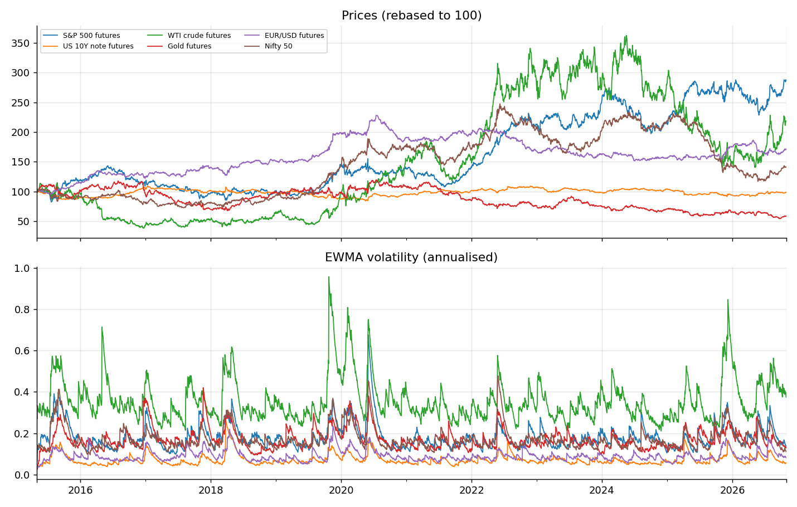
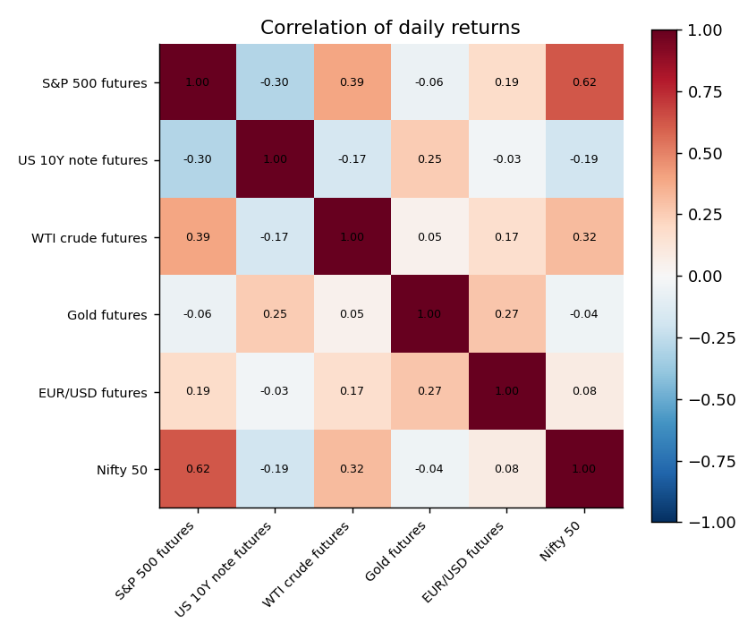
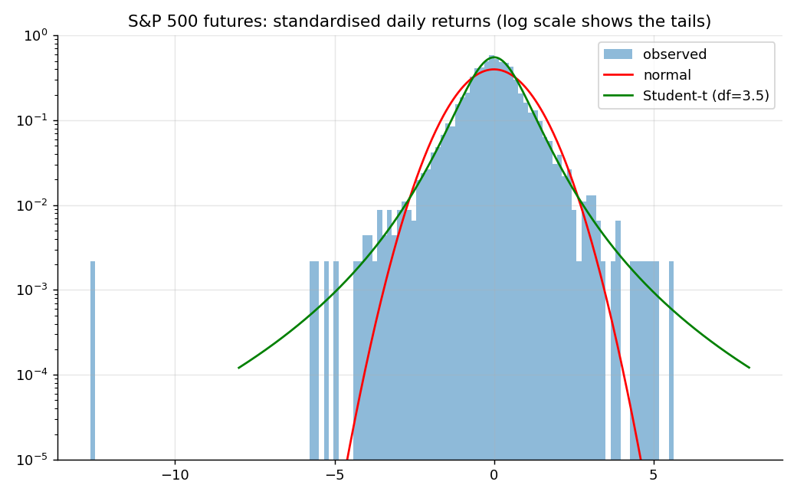
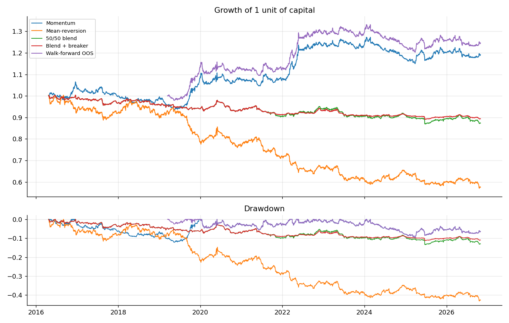
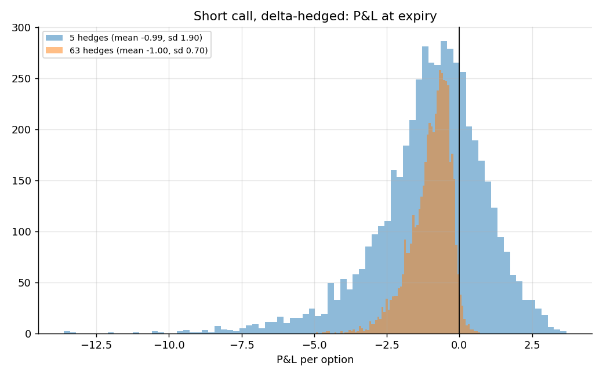

# Futures-style markets project: analysis, probability, risk and decisions

> **SYNTHETIC DATA.** Generated for testing the code offline. None of the numbers below describe real markets.

Data: 6 assets, 2999 daily returns, 2015-05-04 to 2026-10-29.

## 1. Market analysis

|  | ann_return | ann_vol | sharpe | skew | excess_kurtosis | worst_day | best_day | days_beyond_3sd | expected_if_normal | jarque_bera_p |
|---|---|---|---|---|---|---|---|---|---|---|
| S&P 500 futures | 0.088 | 0.192 | 0.461 | -0.706 | 11.917 | -0.152 | 0.069 | 48 | 8.097 | 0 |
| US 10Y note futures | -0.001 | 0.077 | -0.018 | 0.801 | 16.004 | -0.041 | 0.064 | 46 | 8.097 | 0 |
| WTI crude futures | 0.066 | 0.373 | 0.176 | -0.256 | 5.050 | -0.206 | 0.119 | 38 | 8.097 | 0 |
| Gold futures | -0.045 | 0.177 | -0.253 | -0.267 | 5.060 | -0.087 | 0.067 | 42 | 8.097 | 0 |
| EUR/USD futures | 0.045 | 0.095 | 0.478 | 0.558 | 4.897 | -0.038 | 0.044 | 40 | 8.097 | 0 |
| Nifty 50 | 0.029 | 0.182 | 0.159 | -0.067 | 3.750 | -0.081 | 0.067 | 52 | 8.097 | 0 |

`days_beyond_3sd` far above `expected_if_normal` means fat tails: extreme days happen much more often than a normal model says.

### Memory, trend and volatility clustering

|  | lag1_autocorr | lag1_t_stat | ljung_box_p_returns | ljung_box_p_squared | hurst |
|---|---|---|---|---|---|
| S&P 500 futures | -0.044 | -2.390 | 0.202 | 0.000 | 0.527 |
| US 10Y note futures | 0.041 | 2.253 | 0.313 | 0.000 | 0.485 |
| WTI crude futures | -0.023 | -1.242 | 0.151 | 0 | 0.492 |
| Gold futures | 0.049 | 2.698 | 0.050 | 0 | 0.468 |
| EUR/USD futures | 0.016 | 0.901 | 0.000 | 0 | 0.573 |
| Nifty 50 | -0.069 | -3.801 | 0.001 | 0 | 0.570 |

Hurst above 0.5 suggests trending, below 0.5 mean-reverting. A small `ljung_box_p_squared` means volatility clusters (calm and wild periods).

### Calm vs stress days

|  | days | avg_ann_vol | avg_abs_pairwise_corr |
|---|---|---|---|
| calm | 2399 | 0.155 | 0.200 |
| stress | 600 | 0.265 | 0.221 |

Correlations usually rise in stress, so diversification protects least when it is needed most.

### 4-sigma days: observed vs models

|  | k_sigma | observed | normal_model | student_t_model | t_degrees_of_freedom |
|---|---|---|---|---|---|
| S&P 500 futures | 4 | 0.00534 | 0.00006 | 0.00586 | 3.53643 |
| US 10Y note futures | 4 | 0.00534 | 0.00006 | 0.01931 | 2.03898 |
| WTI crude futures | 4 | 0.00367 | 0.00006 | 0.00438 | 4.38896 |
| Gold futures | 4 | 0.00433 | 0.00006 | 0.00480 | 4.13314 |
| EUR/USD futures | 4 | 0.00534 | 0.00006 | 0.00447 | 4.28685 |
| Nifty 50 | 4 | 0.00433 | 0.00006 | 0.00510 | 4.04594 |

## 2. Strategy research (vol-targeted, after costs)

|  | ann_return | ann_vol | sharpe | sortino | max_drawdown | calmar | hit_rate | profit_factor | t_stat |
|---|---|---|---|---|---|---|---|---|---|
| Mean-reversion only | -0.049 | 0.067 | -0.729 | -1.003 | -0.432 | -0.112 | 0.472 | 0.877 | -2.407 |
| Momentum only | 0.017 | 0.047 | 0.364 | 0.503 | -0.122 | 0.141 | 0.504 | 1.070 | 1.203 |
| 50/50 blend | -0.012 | 0.029 | -0.421 | -0.540 | -0.134 | -0.090 | 0.486 | 0.926 | -1.388 |
| 50/50 + drawdown breaker | -0.010 | 0.023 | -0.429 | -0.538 | -0.112 | -0.090 | 0.486 | 0.921 | -1.417 |
| Walk-forward (out of sample) | 0.029 | 0.049 | 0.591 | 0.811 | -0.097 | 0.300 | 0.509 | 1.119 | 1.660 |

Volatility is below the 10% target because signals are rarely at full strength (positions scale with signal size).

Out-of-sample Sharpe 0.59, 95% bootstrap interval [-0.08, 1.26]. If the interval includes 0, the edge is not statistically proven.

### Walk-forward folds (parameter chosen on 3 years, tested on the next unseen year)

| test_start | chosen_mom_weight | in_sample_sharpe | out_of_sample_sharpe |
|---|---|---|---|
| 2019-03-15 | 1 | -0.347 | 1.615 |
| 2020-03-03 | 1 | 0.287 | 0.378 |
| 2021-02-18 | 1 | 0.597 | 0.153 |
| 2022-02-07 | 1 | 0.793 | 2.165 |
| 2023-01-25 | 1 | 1.014 | 0.332 |
| 2024-01-12 | 1 | 1.057 | -1.758 |
| 2024-12-31 | 1 | 0.567 | 0.580 |
| 2025-12-18 | 1 | -0.263 | -0.244 |

### Is the direction call better than a coin flip?
1542 of 3038 strong signals were right (50.8%). Bayesian 95% interval for the true hit rate: [49.0%, 52.5%]; probability it is above 50%: 79.8%.

## 3. Probability toolkit

- **Luck vs skill.** Sharpe -0.42 over 10.9 years: chance of seeing at least this if the true Sharpe were 0 = 91.7%. 

- **Monte Carlo drawdown.** With the blend's return and volatility and fat-tailed shocks, the chance of a drawdown of at least 10% within a year is 0.1% (median worst drawdown 3.5%, 95th percentile 6.8%).

- **Kelly leverage** (mean / variance of daily returns, per asset): S&P 500 futures 2.4x, US 10Y note futures -0.2x, WTI crude futures 0.5x, Gold futures -1.4x, EUR/USD futures 5.1x, Nifty 50 0.9x. Estimated means are noisy, so these are far too high to use; professionals trade a fraction (half Kelly or less).

## 4. Risk management

|  | VaR (1 day) | Expected shortfall |
|---|---|---|
| historical 95% | 0.2705% | 0.4281% |
| normal 95% | 0.3003% | 0.3754% |
| Student-t 95% | 0.3087% | 0.6438% |
| historical 99% | 0.4717% | 0.7531% |
| normal 99% | 0.4228% | 0.4837% |
| Student-t 99% | 0.7179% | 1.4678% |

VaR back-test (rolling 250-day historical, 99%): 34 breaches in 2496 days, expected about 25.0; Kupiec p-value 0.085 (small values mean the VaR model is mis-calibrated).

### Latest positions and risk contributions (portfolio volatility 2.0%)
|  | position | risk_share |
|---|---|---|
| S&P 500 futures | -0.000 | -0.000 |
| US 10Y note futures | 0.031 | -0.008 |
| WTI crude futures | 0.004 | 0.001 |
| Gold futures | -0.089 | 0.690 |
| EUR/USD futures | -0.092 | 0.292 |
| Nifty 50 | 0.020 | 0.025 |

### Stress scenarios (illustrative shocks), P&L as % of capital
|  | pnl_pct_of_capital |
|---|---|
| Equity crash | -0.22% |
| Rates shock (+75bp) | 0.03% |
| Oil spike | 0.20% |
| USD rally | 0.89% |

Risk-limit check on the latest book: scale factor 0.50 (drawdown 13.0%: half size).

## 5. Derivatives: pricing, Greeks, hedging

At-the-money 3-month call (S=K=100, r=5%, vol 20%): price 4.615; implied vol recovered from that price: 0.2000.

|  | value |
|---|---|
| delta | 0.5695 |
| gamma | 0.0393 |
| vega_per_vol_pt | 0.1964 |
| theta_per_day | -0.0287 |
| rho_per_1pct | 0.1308 |

Sell a call at 20% implied vol and delta-hedge. If realised vol is lower you earn, if higher you lose; hedging more often cuts the noise:

|  | mean P&L | std dev | theory (price diff) |
|---|---|---|---|
| realised vol 15%, 5 hedges | 1.003 | 1.148 | 0.996 |
| realised vol 15%, 63 hedges | 0.993 | 0.457 | 0.996 |
| realised vol 20%, 5 hedges | 0.006 | 1.480 | 0 |
| realised vol 20%, 63 hedges | -0.003 | 0.437 | 0 |
| realised vol 25%, 5 hedges | -0.992 | 1.899 | -0.996 |
| realised vol 25%, 63 hedges | -0.999 | 0.695 | -0.996 |

## 6. Decision engine (latest day)

| asset | action | size | hit_rate_lower | stop | target | reason |
|---|---|---|---|---|---|---|
| S&P 500 futures | HOLD | 0 | 0.494 | - | - | hit-rate lower bound 49.4% on 283 past signals is not above 50%: no proven edge |
| US 10Y note futures | HOLD | 0 | 0.442 | - | - | hit-rate lower bound 44.2% on 204 past signals is not above 50%: no proven edge |
| WTI crude futures | HOLD | 0 | 0.477 | - | - | hit-rate lower bound 47.7% on 236 past signals is not above 50%: no proven edge |
| Gold futures | HOLD | 0 | 0.461 | - | - | hit-rate lower bound 46.1% on 187 past signals is not above 50%: no proven edge |
| EUR/USD futures | HOLD | 0 | 0.433 | - | - | hit-rate lower bound 43.3% on 197 past signals is not above 50%: no proven edge |
| Nifty 50 | BUY | 0.068 | 0.536 | 140.190 | 145.150 | score +0.26, hit-rate lower bound 53.6% on 415 signals |

Speed: 100 decisions, median 7.9 ms, 95th percentile 10.6 ms, slowest 11.7 ms.

## 7. Limitations

- Daily data and simple rules; no intraday data, bid/ask spreads, slippage, margin or contract roll effects beyond a flat cost.
- Yahoo continuous futures are back-adjusted and can contain gaps; check data quality before trusting results.
- Past performance does not predict future returns. Stress shocks are assumptions, not forecasts.
- This is a learning and portfolio project, not investment advice.
