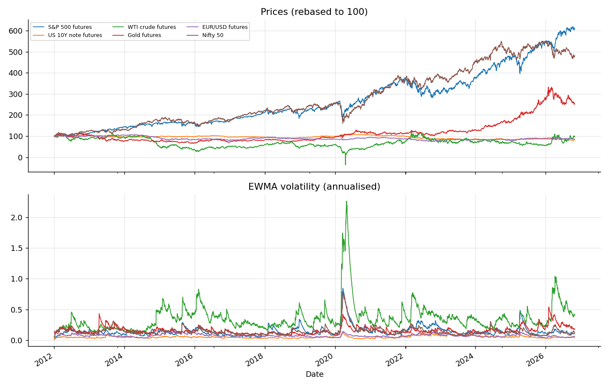
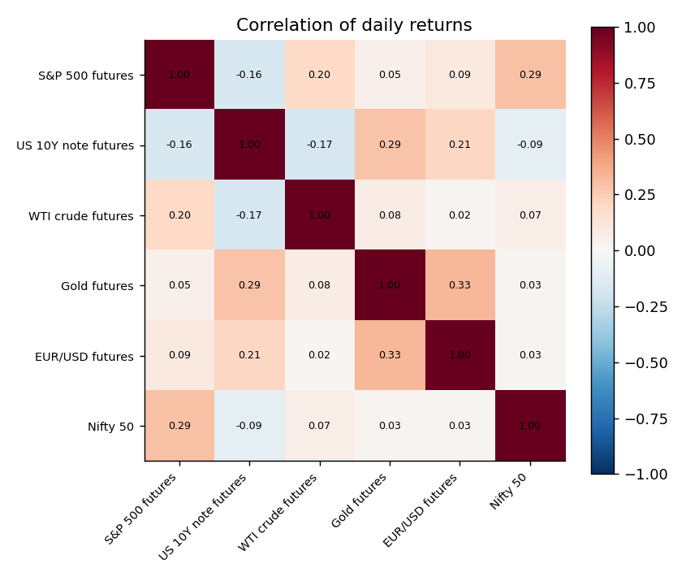
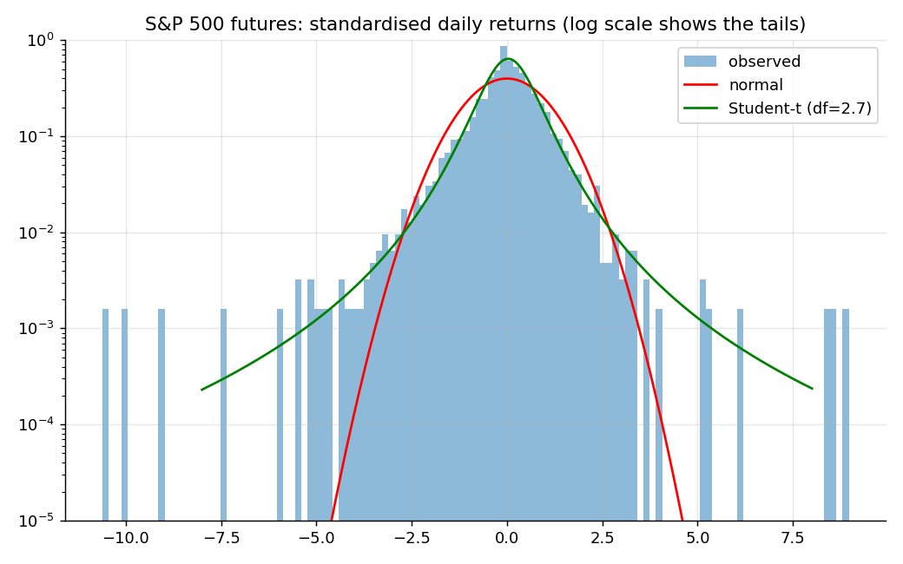
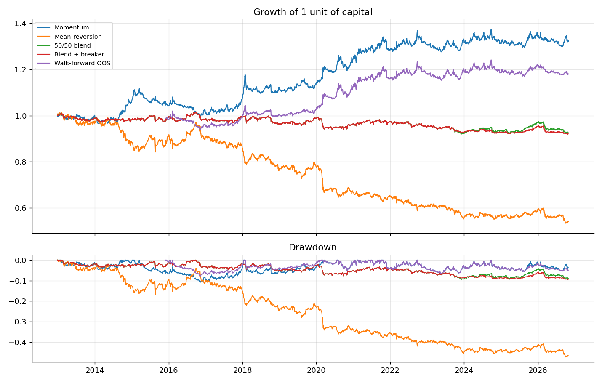
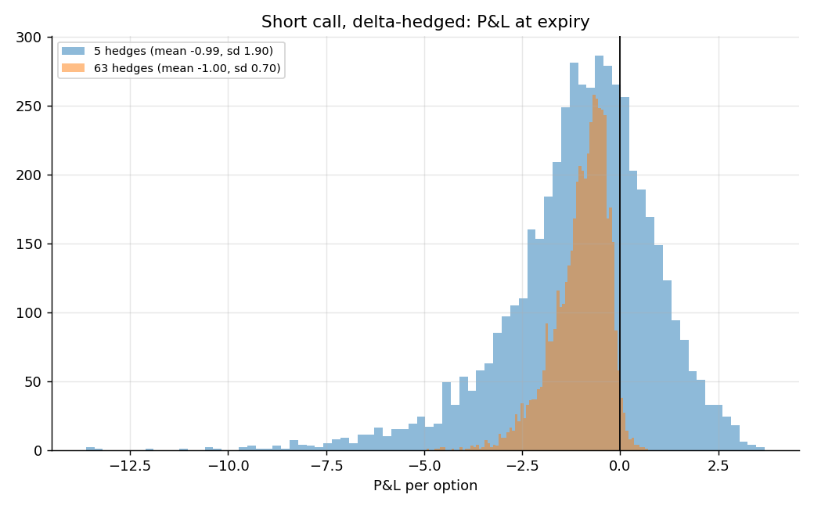

# Futures-style markets project: analysis, probability, risk and decisions

Data: 6 assets, 3829 daily returns, 2012-01-04 to 2026-10-29.

## 1. Market analysis

|  | ann_return | ann_vol | sharpe | skew | excess_kurtosis | worst_day | best_day | days_beyond_3sd | expected_if_normal | jarque_bera_p |
|---|---|---|---|---|---|---|---|---|---|---|
| S&P 500 futures | 0.122 | 0.165 | 0.743 | -0.702 | 15.715 | -0.110 | 0.093 | 53 | 10.338 | 0 |
| US 10Y note futures | -0.014 | 0.052 | -0.268 | 0.025 | 2.805 | -0.022 | 0.020 | 49 | 10.338 | 0 |
| WTI crude futures | 0.039 | 0.422 | 0.092 | -0.035 | 22.578 | -0.282 | 0.320 | 57 | 10.338 | 0 |
| Gold futures | 0.061 | 0.168 | 0.365 | -0.719 | 8.611 | -0.114 | 0.059 | 55 | 10.338 | 0 |
| EUR/USD futures | -0.010 | 0.077 | -0.133 | 0.117 | 2.008 | -0.021 | 0.033 | 46 | 10.338 | 0 |
| Nifty 50 | 0.105 | 0.157 | 0.672 | -1.090 | 17.548 | -0.139 | 0.084 | 45 | 10.338 | 0 |

`days_beyond_3sd` far above `expected_if_normal` means fat tails: extreme days happen much more often than a normal model says.

### Memory, trend and volatility clustering

|  | lag1_autocorr | lag1_t_stat | ljung_box_p_returns | ljung_box_p_squared | hurst |
|---|---|---|---|---|---|
| S&P 500 futures | -0.109 | -6.759 | 0 | 0 | 0.399 |
| US 10Y note futures | -0.021 | -1.275 | 0.448 | 0 | 0.503 |
| WTI crude futures | -0.006 | -0.363 | 0.000 | 0 | nan |
| Gold futures | -0.038 | -2.340 | 0.066 | 0 | 0.488 |
| EUR/USD futures | -0.018 | -1.116 | 0.013 | 0 | 0.506 |
| Nifty 50 | -0.007 | -0.406 | 0.000 | 0 | 0.481 |

Hurst above 0.5 suggests trending, below 0.5 mean-reverting. A small `ljung_box_p_squared` means volatility clusters (calm and wild periods).

### Calm vs stress days

|  | days | avg_ann_vol | avg_abs_pairwise_corr |
|---|---|---|---|
| calm | 3063 | 0.135 | 0.135 |
| stress | 766 | 0.274 | 0.156 |

Correlations usually rise in stress, so diversification protects least when it is needed most.

### 4-sigma days: observed vs models

|  | k_sigma | observed | normal_model | student_t_model | t_degrees_of_freedom |
|---|---|---|---|---|---|
| S&P 500 futures | 4 | 0.00601 | 0.00006 | 0.00861 | 2.66247 |
| US 10Y note futures | 4 | 0.00287 | 0.00006 | 0.02396 | 2.02674 |
| WTI crude futures | 4 | 0.00627 | 0.00006 | 0.00629 | 3.03500 |
| Gold futures | 4 | 0.00470 | 0.00006 | 0.00765 | 3.08591 |
| EUR/USD futures | 4 | 0.00235 | 0.00006 | 0.02353 | 2.07493 |
| Nifty 50 | 4 | 0.00470 | 0.00006 | 0.00571 | 3.47013 |

## 2. Strategy research (vol-targeted, after costs)

|  | ann_return | ann_vol | sharpe | sortino | max_drawdown | calmar | hit_rate | profit_factor | t_stat |
|---|---|---|---|---|---|---|---|---|---|
| Mean-reversion only | -0.041 | 0.066 | -0.623 | -0.837 | -0.473 | -0.087 | 0.485 | 0.896 | -2.345 |
| Momentum only | 0.021 | 0.047 | 0.441 | 0.570 | -0.111 | 0.188 | 0.530 | 1.083 | 1.660 |
| 50/50 blend | -0.005 | 0.029 | -0.177 | -0.223 | -0.095 | -0.053 | 0.505 | 0.968 | -0.667 |
| 50/50 + drawdown breaker | -0.005 | 0.027 | -0.203 | -0.249 | -0.096 | -0.057 | 0.505 | 0.963 | -0.764 |
| Walk-forward (out of sample) | 0.016 | 0.042 | 0.369 | 0.441 | -0.081 | 0.192 | 0.542 | 1.071 | 1.236 |

Volatility is below the 10% target because signals are rarely at full strength (positions scale with signal size).

Out-of-sample Sharpe 0.37, 95% bootstrap interval [-0.17, 0.96]. If the interval includes 0, the edge is not statistically proven.

### Walk-forward folds (parameter chosen on 3 years, tested on the next unseen year)

| test_start | chosen_mom_weight | in_sample_sharpe | out_of_sample_sharpe |
|---|---|---|---|
| 2015-12-03 | 1 | 0.454 | -1.270 |
| 2016-11-25 | 0.750 | 0.259 | 0.655 |
| 2017-11-15 | 0.750 | 0.034 | 0.715 |
| 2018-11-07 | 0.750 | 0.300 | 0.651 |
| 2019-10-31 | 1 | 0.749 | 1.498 |
| 2020-10-26 | 1 | 1.036 | 1.539 |
| 2021-10-15 | 1 | 1.241 | 0.022 |
| 2022-10-05 | 1 | 1.020 | -0.469 |
| 2023-09-25 | 1 | 0.472 | 0.738 |
| 2024-09-13 | 1 | 0.120 | -0.815 |
| 2025-09-03 | 0.750 | -0.056 | 0.034 |
| 2026-08-25 | 0.750 | 0.125 | 0.339 |

### Is the direction call better than a coin flip?
1860 of 3552 strong signals were right (52.4%). Bayesian 95% interval for the true hit rate: [50.7%, 54.0%]; probability it is above 50%: 99.8%.

## 3. Probability toolkit

- **Luck vs skill.** Sharpe -0.18 over 14.2 years: chance of seeing at least this if the true Sharpe were 0 = 74.8%. 

- **Monte Carlo drawdown.** With the blend's return and volatility and fat-tailed shocks, the chance of a drawdown of at least 10% within a year is 0.1% (median worst drawdown 3.2%, 95th percentile 6.4%).

- **Kelly leverage** (mean / variance of daily returns, per asset): S&P 500 futures 4.5x, US 10Y note futures -5.1x, WTI crude futures 0.2x, Gold futures 2.2x, EUR/USD futures -1.7x, Nifty 50 4.3x. Estimated means are noisy, so these are far too high to use; professionals trade a fraction (half Kelly or less).

## 4. Risk management

|  | VaR (1 day) | Expected shortfall |
|---|---|---|
| historical 95% | 0.2864% | 0.4576% |
| normal 95% | 0.2997% | 0.3754% |
| Student-t 95% | 0.2984% | 0.6343% |
| historical 99% | 0.5365% | 0.7583% |
| normal 99% | 0.4231% | 0.4844% |
| Student-t 99% | 0.7095% | 1.4567% |

VaR back-test (rolling 250-day historical, 99%): 45 breaches in 3326 days, expected about 33.3; Kupiec p-value 0.052 (small values mean the VaR model is mis-calibrated).

### Latest positions and risk contributions (portfolio volatility 1.9%)
|  | position | risk_share |
|---|---|---|
| S&P 500 futures | 0.064 | 0.233 |
| US 10Y note futures | -0.242 | 0.107 |
| WTI crude futures | -0.008 | 0.051 |
| Gold futures | 0.048 | 0.498 |
| EUR/USD futures | 0.042 | 0.039 |
| Nifty 50 | -0.062 | 0.072 |

### Stress scenarios (illustrative shocks), P&L as % of capital
|  | pnl_pct_of_capital |
|---|---|
| Equity crash | -0.19% |
| Rates shock (+75bp) | 1.23% |
| Oil spike | -0.23% |
| USD rally | -0.41% |

Risk-limit check on the latest book: scale factor 0.50 (drawdown 9.0%: half size).

## 5. Derivatives: pricing, Greeks, hedging

At-the-money 3-month call (S=K=100, r=5%, vol 20%): price 4.615; implied vol recovered from that price: 0.2000.

|  | value |
|---|---|
| delta | 0.5695 |
| gamma | 0.0393 |
| vega_per_vol_pt | 0.1964 |
| theta_per_day | -0.0287 |
| rho_per_1pct | 0.1308 |

Sell a call at 20% implied vol and delta-hedge. If realised vol is lower you earn, if higher you lose; hedging more often cuts the noise:

|  | mean P&L | std dev | theory (price diff) |
|---|---|---|---|
| realised vol 15%, 5 hedges | 1.003 | 1.148 | 0.996 |
| realised vol 15%, 63 hedges | 0.993 | 0.457 | 0.996 |
| realised vol 20%, 5 hedges | 0.006 | 1.480 | 0 |
| realised vol 20%, 63 hedges | -0.003 | 0.437 | 0 |
| realised vol 25%, 5 hedges | -0.992 | 1.899 | -0.996 |
| realised vol 25%, 63 hedges | -0.999 | 0.695 | -0.996 |

## 6. Decision engine (latest day)

| asset | action | size | hit_rate_lower | stop | target | reason |
|---|---|---|---|---|---|---|
| S&P 500 futures | BUY | 0.012 | 0.506 | 7663.890 | 7914.790 | score +0.25, hit-rate lower bound 50.6% on 466 signals |
| US 10Y note futures | HOLD | 0 | 0.464 | - | - | hit-rate lower bound 46.4% on 207 past signals is not above 50%: no proven edge |
| WTI crude futures | HOLD | 0 | 0.520 | - | - | signal +0.16 too weak |
| Gold futures | HOLD | 0 | 0.548 | - | - | signal +0.02 too weak |
| EUR/USD futures | HOLD | 0 | 0.495 | - | - | hit-rate lower bound 49.5% on 204 past signals is not above 50%: no proven edge |
| Nifty 50 | HOLD | 0 | 0.465 | - | - | hit-rate lower bound 46.5% on 309 past signals is not above 50%: no proven edge |

Speed: 100 decisions, median 7.3 ms, 95th percentile 9.1 ms, slowest 13.2 ms.

## 7. Limitations

- Daily data and simple rules; no intraday data, bid/ask spreads, slippage, margin or contract roll effects beyond a flat cost.
- Yahoo continuous futures are back-adjusted and can contain gaps; check data quality before trusting results.
- Past performance does not predict future returns. Stress shocks are assumptions, not forecasts.
- This is a learning and portfolio project, not investment advice.
